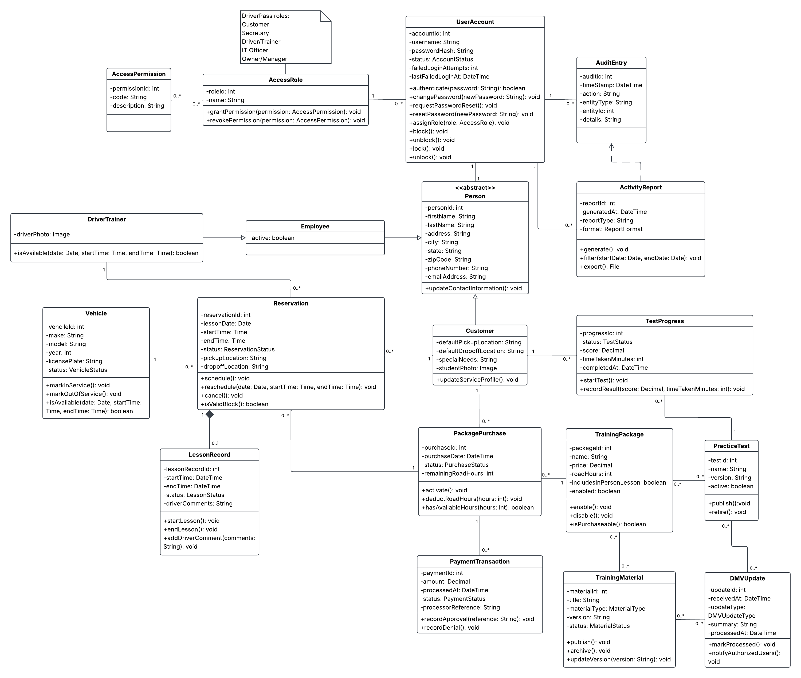

# DriverPass · System Requirements and UML Design

A systems analysis and design case study for a fictional driving education business. The proposed web application connects customer accounts, training packages, practice tests and driving lessons with the employee tools needed to manage reservations, vehicles, records and access.

**Available here** — business requirements, a system design report and six original diagrams. This is an academic design proposal, with no application code or deployed service.

## Start here

| Artifact | What it shows |
|---|---|
| [Business requirements PDF](docs/business-requirements.pdf) · [Word version](docs/business-requirements.docx) | Business goals, functional and nonfunctional requirements, assumptions, limits and project schedule |
| [System design PDF](docs/system-design.pdf) · [Word version](docs/system-design.docx) | UML diagrams and proposed hardware, software, administration and cloud requirements |
| [Use case diagram](diagrams/use-case.png) | Customer, secretary, driver, IT and management responsibilities |
| [Package purchase activity](diagrams/activity-1.png) | Purchase decisions, unavailable packages and failed-payment paths |
| [Lesson comments activity](diagrams/activity-2.png) | Driver workflow for recording comments after a completed lesson |
| [Purchase sequence](diagrams/sequence.png) | Interactions among the application, accounts, package records and external payment processor |
| [Class model](diagrams/class-model.png) | Data, responsibilities and relationships across the proposed system |
| [Project schedule](diagrams/project-schedule.png) | Planning dependencies and fictional personnel assignments |

The image links open the original full-resolution exports. The class model and schedule are best viewed enlarged.

## My contribution

I translated the supplied scenario interview into functional and nonfunctional requirements, then represented those needs in use cases, activity and sequence diagrams, a class model and technical requirements. The work connects the customer-facing parts of the system with the administrative and employee-facing parts that would support the business behind the scenes.

Customers need self-service access to packages, materials, tests and reservations. Employees need ways to assist customers, manage lessons, review records and control access according to their roles. The design accounts for both, rather than treating the customer interface as the whole system.

## Connecting requirements to the design

| Requirement in the business report | Corresponding design evidence |
|---|---|
| Purchase a package through an external payment processor | Purchase activity and sequence diagrams; `PackagePurchase` and `PaymentTransaction` classes |
| Assign customers, drivers and vehicles to lessons while respecting package hours | Scheduling use cases; `Reservation`, `DriverTrainer`, `Vehicle` and `PackagePurchase` classes |
| Let assigned drivers record lesson comments | Lesson-comments activity; `LessonRecord` class |
| Restrict access by role and record relevant actions | `UserAccount`, `AccessRole`, `AccessPermission` and `AuditEntry` classes |

These examples connect the requirements to the relevant design artifacts.

## Design scope

The proposal uses a browser interface, centralized data and cloud hosting. It separates external payment processing from DriverPass's own transaction records and permits offline review of exported information without offline modification of the live database.

Response times, concurrent-session capacity, password handling and access controls are specified design targets. No running system was built or tested against them. The original diagrams are retained as conceptual models; detailed API contracts, database constraints and concurrency handling would still need to be defined during implementation.

## Approach and reflection

My general approach to software design is to start with the base human reality first. Who will be using it, what their goals are, and what has to happen to casually connect A and B. From there, the rest sifts out. Users imply actions, actions imply data, data implies rules, and rules imply all the awkward limitations and security concerns that have to be dealt with before anyone writes code.

The pieces need to be checked against each other constantly. A requirement that never appears in the design, or a design feature that was never actually asked for, is the kind of small mismatch that can quietly become everyone's problem later.

## Background

An undergraduate design project based on a supplied fictional business scenario. The stakeholders and schedule personnel belong to that scenario. See [credits and acknowledgments](CREDITS.md).
